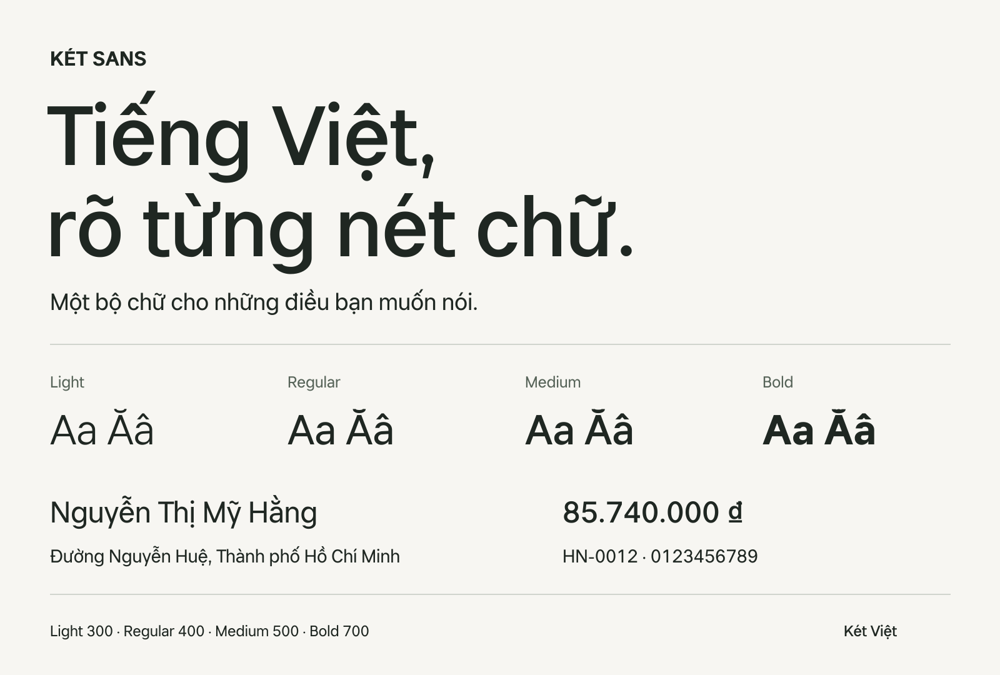

# KÉT Sans

Bộ chữ của Két Việt, dành cho giao diện tiếng Việt. Đường nét trung tính, hình chữ tròn và bốn độ đậm cho nội dung, tiêu đề và dữ liệu.

**[Tải KÉT Sans 1.0](https://github.com/ketvietlab/ket-sans-font/releases/download/v1.0.0/KETSans-1.000.zip)** · [Thông tin bản phát hành](https://github.com/ketvietlab/ket-sans-font/releases/tag/v1.0.0)



## Tiếng Việt, từ nội dung đến dữ liệu

KÉT Sans hỗ trợ đầy đủ chữ và dấu tiếng Việt, bảng chữ Latin Core cùng ký hiệu đồng **₫**. Các chữ số có cùng chiều rộng, giúp số tiền và dữ liệu trong bảng thẳng hàng.

Bốn độ đậm **Light · Regular · Medium · Bold** dùng chung một hệ hình chữ. Trên web, Medium phục vụ cả mức 500 và 600.

Bản **Optical** tự điều chỉnh khoảng cách chữ theo cỡ hiển thị trong ứng dụng có hỗ trợ: giữ nhịp thoáng ở cỡ đọc, thu gọn khoảng cách khi chữ lớn hơn. Gói tải cũng có bản tĩnh để dùng trong các phần mềm khác.

## Chọn font và cài đặt

[Tải và giải nén gói font](https://github.com/ketvietlab/ket-sans-font/releases/download/v1.0.0/KETSans-1.000.zip), rồi chọn định dạng phù hợp:

| Bạn muốn dùng ở đâu? | Thư mục trong gói |
| --- | --- |
| Thiết kế, tài liệu và in ấn | `OTF/` |
| Phần mềm dùng TrueType | `TTF/` — bản tĩnh có hint |
| Website có khoảng cách chữ thay đổi theo cỡ | `Optical/` — dùng các file `.woff2` |
| Website dùng khoảng cách chữ cố định | `WOFF2/` |

**macOS:** mở file `.otf` hoặc `.ttf`, chọn **Cài đặt phông chữ / Install Font**.

**Windows:** nhấp chuột phải vào file, chọn **Install**.

Chỉ cần cài một định dạng của bộ font tĩnh. Nếu muốn dùng Optical trong phần mềm thiết kế, cài các file `.ttf` ở `Optical/`; bộ này có tên **KET Sans Optical** trong danh sách font.

## Dùng trên web

Chép thư mục `Optical/` vào website, rồi điều chỉnh đường dẫn trong CSS dưới đây:

```css
@font-face {
  font-family: "KÉT Sans";
  src: url("./Optical/KETSansOptical-Light.woff2") format("woff2");
  font-weight: 300;
  font-style: normal;
  font-display: swap;
}

@font-face {
  font-family: "KÉT Sans";
  src: url("./Optical/KETSansOptical-Regular.woff2") format("woff2");
  font-weight: 400;
  font-style: normal;
  font-display: swap;
}

@font-face {
  font-family: "KÉT Sans";
  src: url("./Optical/KETSansOptical-Medium.woff2") format("woff2");
  font-weight: 500 600;
  font-style: normal;
  font-display: swap;
}

@font-face {
  font-family: "KÉT Sans";
  src: url("./Optical/KETSansOptical-Bold.woff2") format("woff2");
  font-weight: 700;
  font-style: normal;
  font-display: swap;
}

body {
  font-family: "KÉT Sans", system-ui, sans-serif;
  font-optical-sizing: auto;
}
```

Không cần thêm `letter-spacing` âm để thu khoảng cách chữ. Giữ khai báo `500 600` cho Medium để trình duyệt chọn đúng độ đậm.

Bản 1.0 chưa có italic riêng. Optical chưa có hint căn nét lên lưới; Windows/ClearType và Safari/WebKit chưa được kiểm chứng. Xem [ghi chú tương thích và giới hạn của bản 1.0](RELEASE-NOTES.md#giới-hạn-đã-biết) trước khi triển khai.

## Giấy phép

KÉT Sans được tải và sử dụng miễn phí, kể cả cho mục đích thương mại và nhúng vào website, ứng dụng hoặc tài liệu. Không được sửa đổi hay phân phối lại các file font theo giấy phép hiện hành.

Đọc đầy đủ [KÉT Sans Font License](LICENSE.txt). Source được công khai để tham khảo; KÉT Sans không phải dự án có giấy phép open source.

## Tìm hiểu thêm

- [Thông tin bản phát hành](RELEASE-NOTES.md)
- [Hệ thống thiết kế bộ chữ](FONT-DESIGN-SYSTEM.md)
- [Tài liệu phát triển, build và kiểm thử](DEVELOPMENT.md)
- [Báo lỗi hoặc góp ý](https://github.com/ketvietlab/ket-sans-font/issues)

Một bộ chữ của [Két Việt](https://ketviet.vn).
